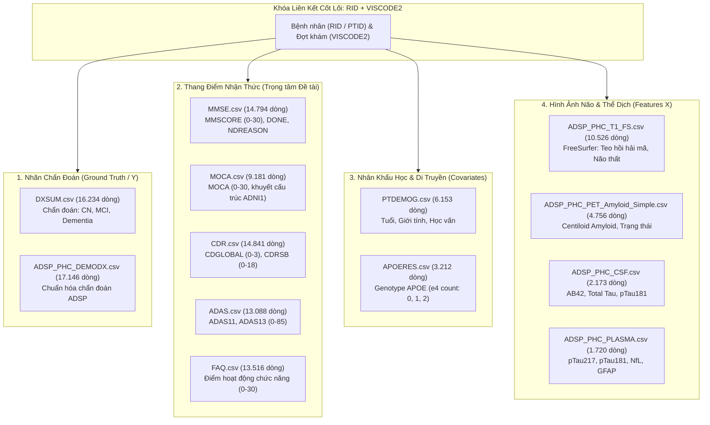

# TÀI LIỆU KỸ THUẬT VÀ ĐẶC TẢ BỘ DỮ LIỆU ADNI (CSV DATASET DOCUMENTATION)
**Đề tài**: Xử lý dữ liệu khuyết ở các thang điểm sàng lọc nhận thức trong dữ liệu đa phương thức sa sút trí tuệ  
**Môn học**: Machine Learning in Medical  
**Nguồn dữ liệu gốc**: Alzheimer's Disease Neuroimaging Initiative (ADNI) — Gói chuẩn `ADNIMERGE2` (ATRI Biostatistics, cập nhật 2026)  
**Tập hợp file dữ liệu**: 226 file CSV trong thư mục `csv_data/` và Từ điển toàn diện `DATADIC_27Sep2026.csv`

---

## 1. TỔNG QUAN VỀ BỘ DỮ LIỆU ADNI

### 1.1. Mục tiêu và thiết kế nghiên cứu
ADNI (**Alzheimer's Disease Neuroimaging Initiative**) là nghiên cứu theo dõi dọc (longitudinal study) quy mô toàn cầu lớn nhất hiện nay về bệnh Alzheimer (AD) và suy giảm nhận thức nhẹ (MCI). Nghiên cứu theo dõi những người tham gia qua nhiều pha liên tiếp:
- **ADNI1** (2004–2009): Pha đầu tiên tập trung vào chẩn đoán lâm sàng, MRI cấu trúc, PET FDG, và xét nghiệm sinh hóa dịch não tủy CSF.
- **ADNIGO** (2009–2011): Mở rộng nghiên cứu sang giai đoạn suy giảm nhận thức nhẹ sớm (Early MCI - EMCI). Bổ sung thang đo **MoCA**.
- **ADNI2** (2011–2016): Tiếp tục theo dõi các cohort cũ và bổ sung người tham gia mới, chụp quét Amyloid PET (Florbetapir AV-45).
- **ADNI3** (2016–2022): Ứng dụng kỹ thuật chụp quét Tau PET (Flortaucipir AV-1451) và công nghệ giải trình tự gen hiện đại.
- **ADNI4** (2022–nay): Tiếp tục mở rộng theo dõi đa phương thức và tăng cường thu thập dấu ấn sinh học qua xét nghiệm máu (plasma biomarkers).

### 1.2. Nguồn gốc của các file CSV trong thư mục
- Toàn bộ dữ liệu dạng bảng được phân phối chính thức từ LONI dưới gói R package `ADNIMERGE2` (phiên bản `0.1.2`, phát hành tháng 9/2026 bởi ATRI Biostatistics).
- Script `export_rda_to_csv.py` đã trích xuất 226 bảng dữ liệu từ các file `.rda` sang định dạng chuẩn `.csv` (mã hóa `utf-8-sig`) lưu tại thư mục `csv_data/`.
- File `DATADIC_27Sep2026.csv` là từ điển dữ liệu chính thức (Data Dictionary) với **79.317 dòng**, mô tả chi tiết từng biến số của **349 bảng dữ liệu**.

---

## 2. CƠ CHẾ KHÓA LIÊN KẾT (PRIMARY & JOIN KEYS)

Để liên kết dữ liệu đa phương thức (nhân khẩu học, nhận thức, dấu ấn sinh học, hình ảnh não bộ) thành bảng phân tích duy nhất, các trường khóa sau được sử dụng làm cơ chế liên kết chính:

| Tên trường (Field) | Kiểu dữ liệu | Ý nghĩa | Ví dụ / Quy ước |
| :--- | :--- | :--- | :--- |
| **`RID`** | Số nguyên (`int`) | Mã định danh duy nhất của người tham gia (Participant Roster ID). Khóa định danh cá nhân ổn định xuyên suốt tất cả các pha. | `2`, `3`, `10898` |
| **`PTID`** | Chuỗi (`str`) | Mã bệnh nhân đầy đủ gồm mã trung tâm + "S" + mã số người bệnh (Site_S_ID). | `011_S_0002`, `022_S_0001` |
| **`VISCODE`** | Chuỗi (`str`) | Mã đợt thăm khám theo thiết kế của từng pha (Visit Code). | `bl` (Baseline), `m06` (Tháng 6), `m12`, `m24`, `m36`... |
| **`VISCODE2`** | Chuỗi (`str`) | Mã đợt thăm khám đã chuẩn hóa đồng nhất giữa các pha (Translated Visit Code). **Nên ưu tiên dùng để liên kết dọc**. | `bl`, `m12`, `m24`, `m48` |
| **`COLPROT`** / **`ORIGPROT`** | Chuỗi / Factor | Pha thu thập dữ liệu (Protocol / Phase). Xác định giao thức nghiên cứu tại thời điểm lấy mẫu hoặc pha tham gia ban đầu. | `ADNI1`, `ADNIGO`, `ADNI2`, `ADNI3`, `ADNI4` |
| **`EXAMDATE`** / **`VISDATE`** | Ngày (`YYYY-MM-DD`) | Ngày khám lâm sàng hoặc ngày thực hiện bài đánh giá/xét nghiệm. | `2005-09-08` |

> **Nguyên tắc liên kết (Merge Rule)**:
> - **Khóa cấp độ thăm khám (Visit-level key)**: `(RID, VISCODE2)` hoặc `(PTID, VISCODE2)` — 1 dòng đại diện cho 1 đợt khám của 1 bệnh nhân.
> - **Khóa cấp độ bệnh nhân (Subject-level key)**: `RID` hoặc `PTID` — dùng cho các bảng hằng định không đổi theo thời gian như nhân khẩu học gốc (`PTDEMOG`) hoặc kiểu gen (`APOERES`).

---

## 3. PHÂN NHÓM CÁC BẢNG DỮ LIỆU CSV CHỦ CHỐT

Trong 226 file CSV, các bảng dưới đây là cốt lõi cho bài toán Machine Learning Y sinh:



---

## 4. ĐẶC TẢ CHI TIẾT TỪNG BẢNG DỮ LIỆU CỐT LÕI

### 4.1. Nhóm 1: Nhãn chẩn đoán bệnh lý (Diagnostic Targets)

#### `DXSUM.csv` (Diagnostic Summary)
- **Số lượng**: 16.234 bản ghi | 42 cột.
- **Ý nghĩa**: Bảng tổng kết chẩn đoán chính thức được xác nhận bởi hội đồng bác sĩ lâm sàng ADNI tại từng đợt khám.
- **Các trường then chốt**:
  - `DIAGNOSIS`: Nhãn chẩn đoán hiện tại, gồm 3 phân lớp chính:
    - `CN` (**Cognitively Normal** - Bình thường): 6.558 bản ghi.
    - `MCI` (**Mild Cognitive Impairment** - Suy giảm nhận thức nhẹ): 6.603 bản ghi.
    - `Dementia` (**Alzheimer's Dementia** - Sa sút trí tuệ): 3.027 bản ghi.
  - `DXCHANGE`: Mã chuyển đổi trạng thái chẩn đoán giữa các đợt khám (ví dụ: từ CN sang MCI, từ MCI sang Dementia hoặc hồi phục).
  - `DXAD`, `DXMCI`, `DXNORM`: Cờ đánh dấu chi tiết nguyên nhân gây suy giảm nhận thức.

#### `ADSP_PHC_DEMODX.csv` (ADSP Harmonized Demographics & Diagnosis)
- **Số lượng**: 17.146 bản ghi | 17 cột.
- **Ý nghĩa**: Bảng chẩn đoán và nhân khẩu học đã qua quy trình chuẩn hóa (harmonization) liên pha bởi Hiệp hội ADSP Ph表type Harmonization Consortium.
- **Các trường then chốt**:
  - `PHC_Diagnosis`: Phân loại mã hóa (1 = CN, 2 = MCI, 3 = Dementia).
  - `PHC_Latest_Diagnosis`: Chẩn đoán ở lần khám gần nhất.
  - `PHC_Age_Diagnosis`: Độ tuổi tại thời điểm có chẩn đoán tương ứng.

---

### 4.2. Nhóm 2: Thang đo & Sàng lọc nhận thức (Cognitive Screening Scales)

#### `MMSE.csv` (Mini-Mental State Examination)
- **Số lượng**: 14.794 bản ghi | 59 cột.
- **Ý nghĩa**: Thang sàng lọc chức năng nhận thức phổ biến nhất thế giới trong lâm sàng thần kinh.
- **Miền giá trị**: Điểm tổng từ 0 đến 30 (điểm càng cao = nhận thức càng tốt; $\ge 24$ thường là bình thường; $19-23$: MCI/sa sút trí tuệ nhẹ; $\le 18$: sa sút trí tuệ vừa đến nặng).
- **Các trường then chốt**:
  - `MMSCORE`: Tổng điểm MMSE (Trung bình: 26.88, Độ lệch chuẩn: 3.82, Min: 0, Max: 30).
  - `DONE`: Cờ ghi nhận có thực hiện được test hay không (`Yes`: 4.621; `No`: 106; `NaN`: các pha trước chưa dùng cờ này).
  - `NDREASON`: Lý do không hoàn thành test (**Biến cực kỳ quan trọng để phân tích cơ chế khuyết MNAR**):
    - *Participant Unable for Cognitive Reasons* (Bệnh nhân mất khả năng do suy giảm nhận thức quá nặng).
    - *Participant/Study Partner Refused* (Từ chối làm bài).
    - *Participant Unable for Other Reasons* (Lý do thể chất, thính lực...).
    - *Site Error* (Lỗi từ trung tâm nghiên cứu - MCAR).
  - `WORD1DL`, `WORD2DL`, `WORD3DL`: Điểm trí nhớ nhớ lại sau trì hoãn (Delayed recall).
  - `MMDRAW`: Điểm bài tập vẽ hình hai ngũ giác lồng nhau (Visuospatial construction).

#### `MOCA.csv` (Montreal Cognitive Assessment)
- **Số lượng**: 9.181 bản ghi | 59 cột.
- **Ý nghĩa**: Thang đánh giá nhận thức có độ nhạy cao hơn MMSE đối với giai đoạn suy giảm nhận thức nhẹ (MCI).
- **Miền giá trị**: 0 đến 30 (điểm dưới 26 gợi ý suy giảm nhận thức).
- **Hiện tượng khuyết đặc biệt (Structural Missingness)**:
  - Chỉ xuất hiện từ các pha **ADNIGO (477), ADNI2 (4.629), ADNI3 (2.626), ADNI4 (1.449)**.
  - **Khuyết 100% ở ADNI1**: Do giao thức ADNI1 thiết kế trước khi MoCA được bổ sung vào quy trình. Không thể coi đây là thiếu ngẫu nhiên đơn thuần, mà là khuyết theo giao thức (Protocol-driven MAR/MNAR).

#### `CDR.csv` (Clinical Dementia Rating)
- **Số lượng**: 14.841 bản ghi | 26 cột.
- **Ý nghĩa**: Thang phân độ mức độ sa sút trí tuệ dựa trên phỏng vấn bán cấu trúc cả bệnh nhân và người chăm sóc (study partner).
- **Các trường then chốt**:
  - `CDGLOBAL`: Điểm phân độ toàn cầu (Global CDR):
    - `0.0`: Nhận thức bình thường (5.507 bản ghi)
    - `0.5`: Nghi ngờ / Suy giảm nhận thức nhẹ - MCI (6.961 bản ghi)
    - `1.0`: Sa sút trí tuệ mức độ nhẹ (1.616 bản ghi)
    - `2.0`: Sa sút trí tuệ mức độ vừa (401 bản ghi)
    - `3.0`: Sa sút trí tuệ mức độ nặng (103 bản ghi)
    - `-1.0`: Mã quy ước dữ liệu khuyết/chưa xác định (86 bản ghi, **cần chuyển thành NaN**).
  - `CDRSB`: Tổng điểm tổng hợp 6 lĩnh vực (CDR Sum of Boxes), từ **0.0 đến 18.0** (Mean: 1.94, SD: 2.79). Là biến liên tục nhạy nhất để theo dõi tiến triển bệnh trong các thử nghiệm lâm sàng.

#### `ADAS.csv` (Alzheimer's Disease Assessment Scale - Cognitive Subscale)
- **Số lượng**: 13.088 bản ghi | 17 cột.
- **Ý nghĩa**: Bộ công cụ đo lường nhận thức chi tiết thường dùng làm tiêu chuẩn đánh giá hiệu quả thuốc trong các thử nghiệm can thiệp AD.
- **Các trường then chốt**:
  - `TOTSCORE` (ADAS-Cog 11 mục): Điểm từ 0 đến 70 (**Điểm càng cao thì bệnh càng nặng**).
  - `TOTAL13` (ADAS-Cog 13 mục): Điểm từ 0 đến 85 (bổ sung bài kiểm tra độ trễ nhớ số và khả năng hủy chữ).

#### `FAQ.csv` (Functional Activities Questionnaire)
- **Số lượng**: 13.516 bản ghi | 28 cột.
- **Ý nghĩa**: Đánh giá 10 hoạt động sống độc lập thường ngày (IADL) do người nhà báo cáo.
- **Thang điểm**: 0 đến 30 (điểm $\ge 9$ báo hiệu mất khả năng sống độc lập, hỗ trợ phân biệt rõ giữa MCI và Dementia).

---

### 4.3. Nhóm 3: Nhân khẩu học & Di truyền học (Demographics & Genetics)

#### `PTDEMOG.csv` (Participant Demographics)
- **Số lượng**: 6.153 bản ghi | 85 cột.
- **Các trường then chốt**:
  - `PTGENDER`: Giới tính (`1` = Nam, `2` = Nữ).
  - `PTDOB` / `PTDOBYY`: Năm sinh (dùng tính tuổi chính xác tại từng đợt khám: `Age = Visit_Year - PTDOBYY`).
  - `PTEDUCAT`: Số năm đi học chính quy (Education years, yếu tố dự trữ nhận thức - Cognitive Reserve quan trọng).
  - `PTETHCAT` / `PTRACCAT`: Dân tộc và chủng tộc.

#### `APOERES.csv` (Apolipoprotein E Genotyping)
- **Số lượng**: 3.212 bản ghi | 17 cột.
- **Ý nghĩa**: Đột biến gen APOE alen $\epsilon 4$ là yếu tố nguy cơ di truyền quan trọng nhất của bệnh Alzheimer khởi phát muộn.
- **Các trường then chốt**:
  - `GENOTYPE`: Kiểu gen hai alen (`3/3`, `3/4`, `4/4`, `2/3`, `2/4`, `2/2`).
  - **Kỹ thuật trích xuất đặc trưng**: Tạo biến `APOE4_count` đếm số lượng alen 4:
    - `0` alen: `2/2`, `2/3`, `3/3` (nguy cơ chuẩn).
    - `1` alen: `2/4`, `3/4` (nguy cơ tăng gấp 3–4 lần).
    - `2` alen: `4/4` (nguy cơ tăng gấp 8–12 lần).

---

### 4.4. Nhóm 4: Dấu ấn sinh học hình ảnh Thần kinh (Neuroimaging Biomarkers)

#### `ADSP_PHC_T1_FS.csv` (FreeSurfer T1-MRI Harmonized Volumetric Features)
- **Số lượng**: 10.526 bản ghi | 412 cột.
- **Ý nghĩa**: Đặc trưng thể tích và độ dày vỏ não trích xuất từ ảnh cộng hưởng từ T1 qua phần mềm FreeSurfer, đã được chuẩn hóa hiệu ứng máy chụp (batch effect) bằng thuật toán ComBat.
- **Các đặc trưng kinh điển liên quan đến Alzheimer**:
  - `Left_Hippocampus_combat`, `Right_Hippocampus_combat`: Thể tích hồi hải mã hai bên (vùng não chịu thoái hóa đầu tiên và nghiêm trọng nhất trong AD).
  - `Left_Lateral_Ventricle_combat`, `Right_Lateral_Ventricle_combat`: Thể tích não thất bên (tăng kích thước do teo nhu mô não xung quanh).
  - `BrainSegVol_combat`: Thể tích toàn bộ não bộ.
  - `EstimatedTotalIntraCranialVol` (ICV): Tổng thể tích nội sọ (dùng để chuẩn hóa tỷ lệ thể tích: `Volume / ICV`).

#### `ADSP_PHC_PET_Amyloid_Simple.csv` & `Tau_Simple.csv` (PET Scans)
- **Số lượng**: Amyloid: 4.756 dòng; Tau: 2.280 dòng.
- **Ý nghĩa**: Định lượng mức độ lắng đọng mảng sinh amyloid-$\beta$ và đám rối tơ thần kinh Tau trong mô não sống.
- **Các trường then chốt**:
  - `PHC_CENTILOIDS`: Thang đo chuẩn hóa Centiloid (0 = người trẻ bình thường, 100 = bệnh nhân AD điển hình). Ngưỡng $\ge 20$ thường coi là dương tính với Amyloid (`PHC_AMYLOID_STATUS`).
  - `PHC_AMYLOID_STATUS`: Trạng thái định tính (`Positive` / `Negative`).

---

### 4.5. Nhóm 5: Dấu ấn sinh học thể dịch (Fluid Biomarkers: CSF & Máu)

#### `ADSP_PHC_CSF.csv` (Dịch não tủy CSF)
- **Số lượng**: 2.173 bản ghi | 21 cột.
- **Dấu ấn sinh học bộ ba (ATN framework)**:
  - `PHC_AB42`: Nồng độ Amyloid-beta 42 (giảm trong CSF khi mảng tích tụ vào não).
  - `PHC_Tau`: Nồng độ Total Tau (tăng khi tế bào thần kinh bị tổn thương/hoại tử).
  - `PHC_pTau181`: Nồng độ Phosphorylated Tau 181 (tăng đặc hiệu với bệnh lý Alzheimer).
  - `AB42pTau181_Class`: Tỷ lệ kết hợp phân loại dương tính/âm tính.

#### `ADSP_PHC_PLASMA.csv` (Huyết tương máu)
- **Số lượng**: 1.720 bản ghi | 23 cột.
- **Xu hướng mới nhất**: Định lượng dấu ấn qua xét nghiệm máu ít xâm lấn (p-tau217, p-tau181, NfL - Neurofilament Light Chain, GFAP - Glial Fibrillary Acidic Protein).

---

## 5. CƠ CHẾ DỮ LIỆU KHUYẾT & THÁCH THỨC "ARTIFICIAL NORMALCY"

### 5.1. Ba cơ chế khuyết trong dữ liệu ADNI
1. **MCAR (Missing Completely at Random)**:
   - Dữ liệu thiếu ngẫu nhiên do nguyên nhân kỹ thuật, ví dụ: lỗi thiết bị quét hình ảnh hỏng (`Site Error`), mẫu máu bị vỡ ống nghiệm không đo được.
2. **MAR (Missing at Random - Protocol Driven)**:
   - Dữ liệu thiếu theo cấu trúc giao thức của từng pha nghiên cứu. Ví dụ: Thang **MoCA khuyết 100% trong ADNI1** vì pha này chưa đưa bài test vào quy trình nghiên cứu. Xác suất thiếu hoàn toàn giải thích được qua biến `COLPROT = 'ADNI1'`.
3. **MNAR (Missing Not at Random - Informative Missingness)**:
   - Bệnh nhân ở giai đoạn sa sút trí tuệ nặng (`Dementia`) thường mệt mỏi, mất phương hướng hoặc bỏ dở bài kiểm tra MMSE/ADAS vì không thể đọc, viết hoặc vẽ được (`NDREASON = 'Participant Unable for Cognitive Reasons'`).
   - Tần suất thiếu tăng vọt ở các lần tái khám sau (`m24`, `m36`, `m48`) do bệnh nhân bệnh nặng đã chuyển vào viện dưỡng lão hoặc qua đời (attrition bias).

### 5.2. Hiểm họa "Artificial Normalcy" khi điền khuyết (Imputation)
- **Khái niệm**: Khi sử dụng các giải pháp điền khuyết đơn giản như **Mean Imputation**, **Median Imputation**, hoặc thậm chí các mô hình hồi quy không xét đến cơ chế MNAR, giá trị điền vào của bệnh nhân nặng (vốn có điểm MMSE thật sự rất thấp $\le 15$) bị kéo ngược về giá trị trung bình mẫu ($\approx 26.8$).
- **Hậu quả lâm sàng & mô hình**:
  - Làm xóa nhòa ranh giới chẩn đoán giữa các nhóm **MCI** và **Dementia**.
  - Tăng đột biến tỷ lệ **False Negative** (bỏ sót bệnh nhân nặng, phân loại nhầm thành nhẹ/bình thường).
  - Phá vỡ mối liên hệ sinh học giữa teo não (MRI) và suy giảm nhận thức.

---

## 6. HƯỚNG DẪN TRA CỨU TỪ ĐIỂN DỮ LIỆU BẰNG PYTHON

Tệp `DATADIC_27Sep2026.csv` cho phép tra cứu tức thì ý nghĩa của bất kỳ trường nào trong 226 file CSV:

```python
import pandas as pd

# Tải từ điển dữ liệu
datadict = pd.read_csv("DATADIC_27Sep2026.csv", low_memory=False)

def lookup_variable(table_name, field_name=None):
    sub = datadict[datadict['TBLNAME'].str.upper() == table_name.upper()]
    if field_name:
        sub = sub[sub['FLDNAME'].str.upper() == field_name.upper()]
    return sub[['PHASE', 'TBLNAME', 'FLDNAME', 'TEXT', 'TYPE', 'CODE', 'UNITS']].dropna(how='all')

# Ví dụ 1: Tra cứu ý nghĩa trường MMSCORE trong bảng MMSE
print(lookup_variable("MMSE", "MMSCORE"))

# Ví dụ 2: Tra cứu các biến trong bảng CDR
print(lookup_variable("CDR")[['FLDNAME', 'TEXT']].head(10))
```

---

## 7. PIPELINE MẪU: ĐỌC, LÀM SẠCH VÀ LIÊN KẾT BẢNG (JOIN DATASET)

Đoạn code hoàn chỉnh dưới đây liên kết các bảng chính thành một `analysis_dataset.csv` phục vụ huấn luyện mô hình Machine Learning:

```python
from pathlib import Path
import numpy as np
import pandas as pd

# Đường dẫn thư mục chứa 226 file CSV
csv_dir = Path(r"D:/1_Kỳ học/2026.1/Machine learning in medical/csv_data")

# 1. Đọc các bảng cốt lõi
dx = pd.read_csv(csv_dir / "DXSUM.csv", low_memory=False)
mmse = pd.read_csv(csv_dir / "MMSE.csv", low_memory=False)
cdr = pd.read_csv(csv_dir / "CDR.csv", low_memory=False)
moca = pd.read_csv(csv_dir / "MOCA.csv", low_memory=False)
demo = pd.read_csv(csv_dir / "PTDEMOG.csv", low_memory=False)
apoe = pd.read_csv(csv_dir / "APOERES.csv", low_memory=False)

# 2. Làm sạch mã thiếu đặc biệt (-1, -4, mã quy ước)
cdr['CDGLOBAL'] = cdr['CDGLOBAL'].replace(-1.0, np.nan)
cdr['CDRSB'] = cdr['CDRSB'].replace(-1.0, np.nan)
mmse['MMSCORE'] = mmse['MMSCORE'].replace(-1, np.nan)

# 3. Trích xuất đặc trưng kiểu gen APOE (APOE4 Allele Count)
def get_apoe4_count(gt):
    if pd.isna(gt):
        return np.nan
    gt_str = str(gt)
    return gt_str.count('4')

apoe['APOE4_count'] = apoe['GENOTYPE'].apply(get_apoe4_count)
apoe_sub = apoe[['RID', 'APOE4_count']].drop_duplicates(subset=['RID'])

# 4. Trích xuất nhân khẩu học tại baseline (Subject level)
demo_sub = demo[['RID', 'PTGENDER', 'PTDOBYY', 'PTEDUCAT']].drop_duplicates(subset=['RID'])

# 5. Lọc bảng chẩn đoán chính
dx_sub = dx[['RID', 'VISCODE2', 'EXAMDATE', 'COLPROT', 'DIAGNOSIS']].dropna(subset=['DIAGNOSIS'])

# 6. Liên kết dữ liệu theo cấp độ lần khám (RID + VISCODE2)
merged = dx_sub.merge(
    mmse[['RID', 'VISCODE2', 'MMSCORE', 'DONE', 'NDREASON']], 
    on=['RID', 'VISCODE2'], how='left'
)

merged = merged.merge(
    cdr[['RID', 'VISCODE2', 'CDGLOBAL', 'CDRSB']], 
    on=['RID', 'VISCODE2'], how='left'
)

merged = merged.merge(
    moca[['RID', 'VISCODE2', 'MOCA']], 
    on=['RID', 'VISCODE2'], how='left'
)

# 7. Ghép các biến nhân khẩu học và di truyền theo RID
merged = merged.merge(demo_sub, on='RID', how='left')
merged = merged.merge(apoe_sub, on='RID', how='left')

# 8. Tính tuổi tại thời điểm khám (Visit Age)
merged['EXAM_YEAR'] = pd.to_datetime(merged['EXAMDATE'], errors='coerce').dt.year
merged['AGE'] = merged['EXAM_YEAR'] - merged['PTDOBYY']

print("=== HOÀN THÀNH LIÊN KẾT ===")
print(f"Tổng số bản ghi: {len(merged)}")
print(f"Số người tham gia (unique subjects): {merged['RID'].nunique()}")
print("\nPhân phối nhãn chẩn đoán:")
print(merged['DIAGNOSIS'].value_counts())
print("\nTỷ lệ khuyết của các thang điểm nhận thức:")
print(merged[['MMSCORE', 'MOCA', 'CDRSB']].isna().mean() * 100)
```

---

## 8. TÓM TẮT THỐNG KÊ QUAN TRỌNG

| Tiêu chí | Số liệu thực tế trong dữ liệu |
| :--- | :--- |
| **Tổng số bảng dữ liệu CSV** | 226 bảng |
| **Tổng số định nghĩa trong từ điển** | 79.317 trường thuộc 349 bảng |
| **Số lượt khám có nhãn chẩn đoán (`DXSUM`)** | 16.234 đợt khám (CN: 6.558; MCI: 6.603; Dementia: 3.027) |
| **Thang điểm MMSE (`MMSCORE`)** | 14.794 đợt khám (Mean: 26.88; SD: 3.82) |
| **Thang điểm MoCA (`MOCA`)** | 9.181 đợt khám (Khuyết 100% trong ADNI1 do Protocol) |
| **Thang điểm CDR-SB (`CDRSB`)** | 14.591 đợt khám (Mean: 1.94; SD: 2.79) |
| **Số lượng người tham gia có kiểu gen (`APOERES`)** | 3.212 bệnh nhân |
| **Số lượng bản ghi đo thể tích não T1-MRI (`FreeSurfer`)** | 10.526 đợt quét với 412 đặc trưng thể tích |
